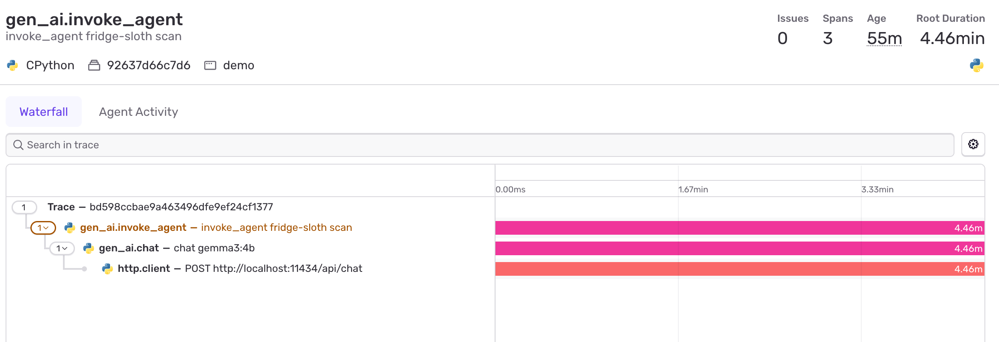
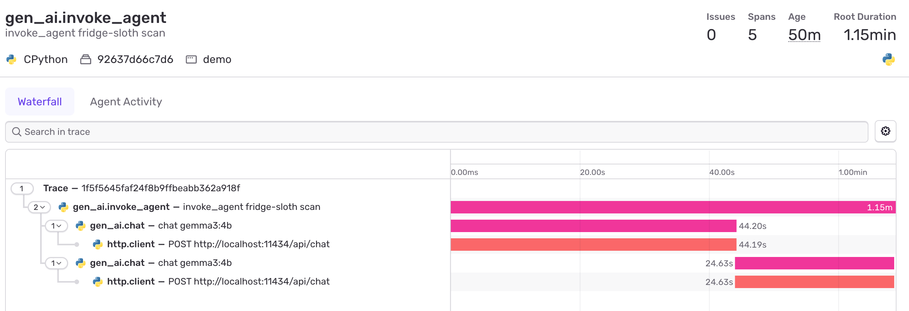
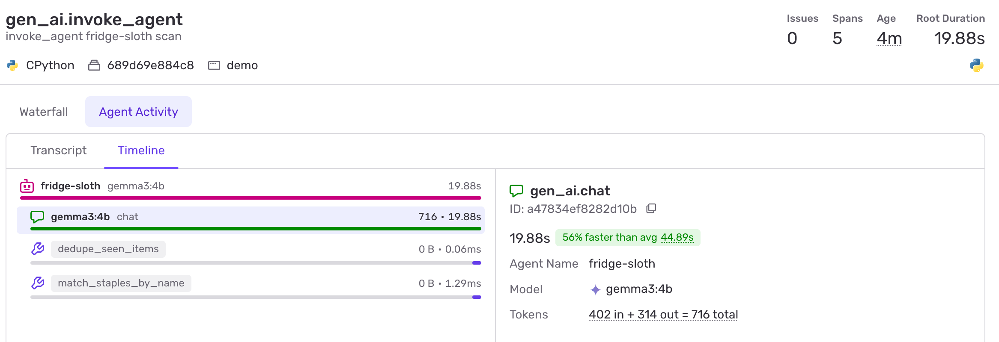
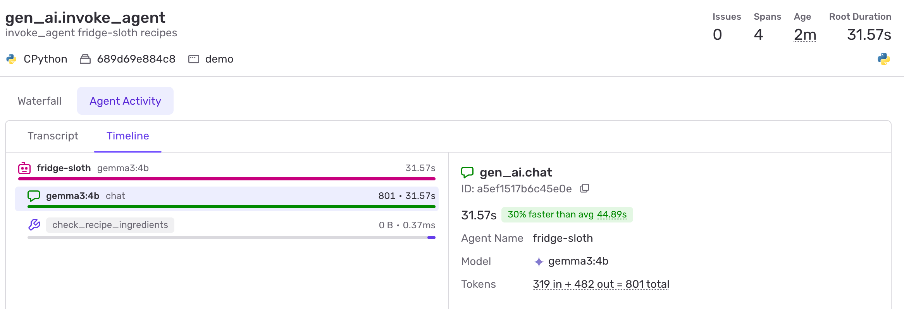

# Fridge Sloth 🦥

[](https://github.com/finallyjay/fridge-sloth/actions/workflows/ci.yml)
[](LICENSE)
[](https://www.python.org/downloads/)
[](https://ai.google.dev/gemma)

Snap a photo of your fridge, get a **grocery list** and **three healthy meals** you can cook with what's already there.
Runs fully offline on [Gemma 3](https://ai.google.dev/gemma) through [Ollama](https://ollama.com). Your fridge photo never leaves your machine.

Built for the [Hacktoberfest Open-Source AI Challenge, Week 3: Slow and Steady](https://dev.to/challenges/hacktoberfest-week3-2026-10-19).

## How it works

```
┌──────────────┐   1. vision (no hints)   ┌──────────────────────┐
│ fridge photo │ ───────────────────────> │ items actually seen  │
└──────────────┘        Gemma 3           │ + amount left        │
                                          └──────────┬───────────┘
┌──────────────┐   2. match by name                  │
│ your staples │ ────────────────────────────────────┤
└──────────────┘     plain code, ~1 ms               │
                                          ┌──────────▼───────────┐
                                          │ grocery list         │
                                          │ (missing / low)      │
                                          └──────────┬───────────┘
                     3. healthy recipes              │
                          Gemma 3         ┌──────────▼───────────┐
                                          │ 3 meals, ≤ 30 min    │
                                          └──────────────────────┘
```

1. **Vision:** Gemma lists the food it can actually see in the photo, with a rough amount (`plenty`, `some`, `low`).
   It is *not* shown your staples list. When it was, it "found" staples that weren't there.
2. **Matching:** your staples (the things you always want at home) are matched against what was seen **by name, in plain
   code**: "cheddar cheese" is cheese, but "tomato sauce" is not tomatoes. Anything missing or low goes on the grocery list.
   This used to be a second Gemma call. Sentry traces showed it took ~25 s, and the 4B model over-claimed matches,
   so it's now ~1 ms and stricter. Missing a synonym only means buying something you already have.
3. **Recipes:** Gemma suggests three healthy meals built mostly from what's in the fridge: real dishes based on
   vegetables, whole grains, legumes, eggs, fish or lean protein, 30 minutes or less, at most 5 steps.
   Any "from your fridge" ingredient that wasn't actually seen is moved to the grocery list.
   Missing ingredients can be added to the grocery list with one tap.

Every call uses a JSON schema in Ollama's `format` field, so the server always gets structured data back.

## Setup

### 1. Install Ollama and pull Gemma

```shell
brew install ollama          # or see https://ollama.com/download
brew services start ollama
ollama pull gemma3:4b        # ~3 GB
```

### 2. Run Fridge Sloth

There are no Python dependencies; only the standard library is used.

```shell
python3 server.py
```

Open http://localhost:8000, take or upload a photo of your fridge and wait about a minute.
To use your phone's camera, open `http://<your-computer's-local-IP>:8000` on the same Wi-Fi.

### Configuration

| Variable       | Default                  | Description                                   |
|----------------|--------------------------|-----------------------------------------------|
| `FRIDGE_MODEL` | `gemma3:4b`              | Any Ollama model with vision, e.g. `gemma3:12b` |
| `OLLAMA_URL`   | `http://localhost:11434` | Where Ollama is running                       |
| `PORT`         | `8000`                   | Port for the web app                          |

Your staples list is saved to `staples.json` next to `server.py` (ignored by git).

### Optional: Sentry Agent Tracing

Want to see where the time goes? Fridge Sloth can send traces to [Sentry Agent Tracing](https://docs.sentry.io/product/agents/getting-started/).
It's **off unless you set `SENTRY_DSN`**:

```shell
pip install -r requirements-sentry.txt
SENTRY_DSN=https://...ingest.sentry.io/... python3 server.py
```

Each scan or recipe request becomes an `invoke_agent` trace with a `chat` span per Gemma call (`vision`, `recipes`)
and an `execute_tool` span for each check the server runs on Gemma's output (`dedupe_seen_items`,
`match_staples_by_name`, `check_recipe_ingredients`),
with the model, token counts and Ollama's own timings (model load, prompt processing, generation).

What it looks like for the messy example photo, before and after the fix in #4:

| Before: Gemma loops in the vision step for 4.5 min, then the scan fails | After: vision 44 s, matching 25 s |
|---|---|
|  |  |

And after moving staples matching out of Gemma: a scan is one Gemma call plus two ~1 ms checks (Sentry's Agent Activity view).





**Only metadata is sent**, in traces and in error reports. The photo, the prompts and Gemma's answers never leave your machine;
[a test](tests/test_tracing.py) checks exactly that.

## Try it with the example photos

`examples/photos/` has a few real fridge photos from Wikimedia Commons (see [credits](examples/CREDITS.md)).
With the server running:

```shell
python3 scripts/try_photo.py examples/photos/usda-0017.jpg
```

On an M1 MacBook (16 GB), a scan takes about 45 s and the recipes about 30 s with `gemma3:4b`.

## Demo video

The demo is a real run of the app, recorded with a scripted browser. Its voice-over is generated with
[ElevenLabs](https://elevenlabs.io) text-to-speech by `scripts/narrate_demo.py`: one line per moment in the video,
stitched so it sounds like one take, then mixed under the recording with ffmpeg.

```shell
pip install -r requirements-demo.txt
npx -y @elevenlabs/cli@latest onboard init   # signs you in and puts ELEVENLABS_API_KEY in .env
python3 scripts/narrate_demo.py silent.mp4 fridge-sloth-demo.mp4
```

## Limitations

- Works well on clear, well-lit photos. On messy or dim ones, the 4B model can miss items or misread them
  (in testing it called a pack of beer "juice bottles").
- It can only see what's in the photo: items hidden behind others or in opaque containers are skipped,
  so a staple can show up as missing when it's just out of view.
- Recipes are only as good as the ingredient list, and are suggestions, not nutritional advice.

## Development

```shell
python3 -m venv .venv
.venv/bin/pip install -r requirements-dev.txt
.venv/bin/pre-commit install

.venv/bin/ruff check . && .venv/bin/ruff format --check .
.venv/bin/mypy server.py tracing.py scripts tests
.venv/bin/pytest
```

Tests mock Gemma, so they run without Ollama.

## License

[MIT](LICENSE). The example photos keep their original licenses, listed in [examples/CREDITS.md](examples/CREDITS.md).
